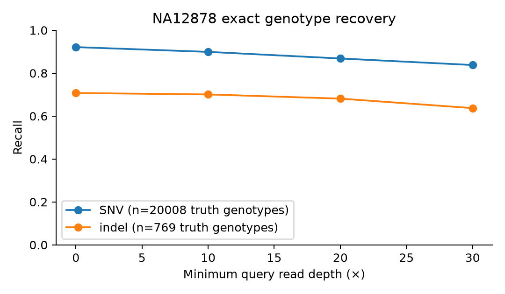
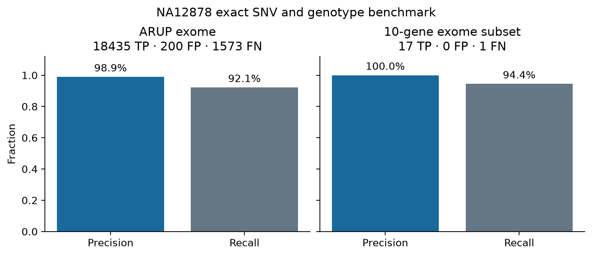
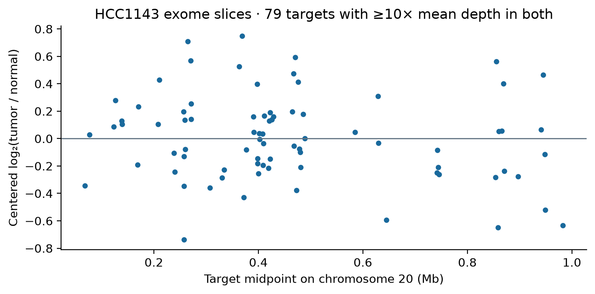
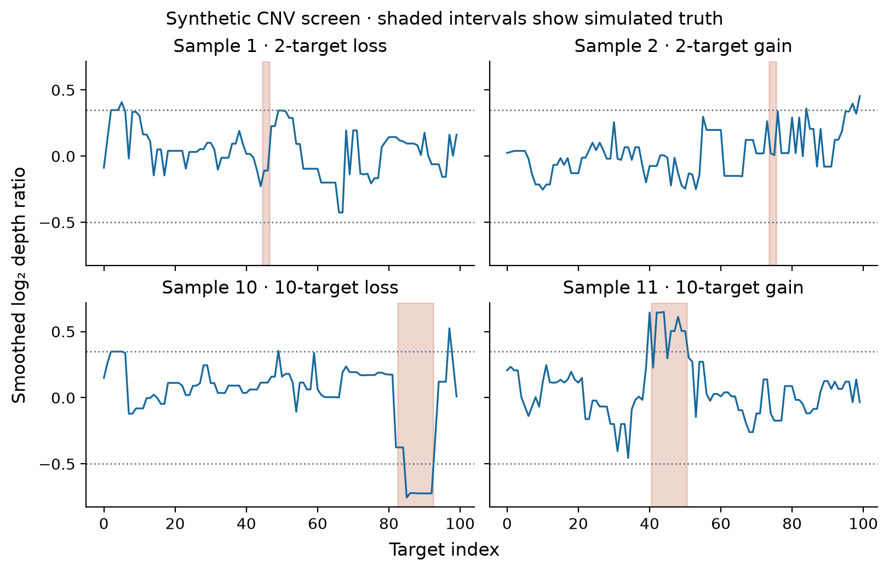

# Exome Genotype Benchmarking and Tumor–Normal Copy-Ratio Analysis

How do allele class, sequencing depth and normalization affect recovery? Across 31,561,021 confident autosomal capture bases, exact genotype F1 was 95.41% for SNVs and 76.78% for indels. The separate simulated CNV analysis reduced false positives across four evaluation seeds. On the original holdout both configurations recovered 145 true targets, with only 113 shared. Across the three additional seeds, the locked configuration recovered fewer true targets each time. The real array comparison covered too few independent segments to estimate CNV accuracy.



[Audited data](../comparative_genomics/sequencing/normalized_crosscheck.tsv) · [Full methods and reproduction](../comparative_genomics/README.md) · [Scientific audit](../FINAL_AUDIT.md)

## Baseline experiment

This project evaluates published NA12878 exome SNVs across the capture design and a 10-gene subset. It also measures real HCC1143 tumor/normal exome-slice coverage and explores relative copy ratios. A separate synthetic CNV benchmark evaluates copy-state recovery against known simulated states.

## NA12878 exome and panel benchmark

The [Zenodo v2 dataset](https://doi.org/10.5281/zenodo.3636192) provides normalized ARUP exome calls, the matching SeqCap EZ capture BED, the GIAB v3.3.2 truth VCF and confident BED, and GRCh37 OMIM gene spans. This run verified all five published MD5 checksums. The panel intersects ATM, BRCA1, BRCA2, MLH1, MSH2, MSH6, PALB2, PMS2, PTEN and TP53 gene spans with the capture BED. The panel uses the same real exome callset, so its metrics are a subset of the WES analysis.

```bash
p=exome_gene_panel_cnv_analysis
d="$p/data"
o="$p/results"
mkdir -p "$d" "$o"
for name in ARUP_SeqCap_EZ_Exome.bed \
  converted_ARUP_NA12878_Exome-decomposed-normalized.vcf.gz \
  GIAB_v3.3.2_NA12878-decomposed-normalized.vcf.gz GIAB_v3.3.2_NA12878_HC_regions.bed Omim_Genes.bed; do
  curl -fLsS "https://zenodo.org/records/3636192/files/$name?download=1" -o "$d/$name"
done
python3 "$p/make_panel.py" --genes "$d/Omim_Genes.bed" --capture "$d/ARUP_SeqCap_EZ_Exome.bed" \
  --out "$o/hereditary_cancer_panel.bed"
for label in wes panel; do
  bed="$d/ARUP_SeqCap_EZ_Exome.bed"
  if [ "$label" = panel ]; then bed="$o/hereditary_cancer_panel.bed"; fi
  python3 "$p/run.py" --truth "$d/GIAB_v3.3.2_NA12878-decomposed-normalized.vcf.gz" \
    --query "$d/converted_ARUP_NA12878_Exome-decomposed-normalized.vcf.gz" \
    --targets "$bed" --confidence "$d/GIAB_v3.3.2_NA12878_HC_regions.bed" --autosomes-only \
    --out "$o/$label.json"
done
bash "$p/crosscheck.sh" > "$o/benchmark_crosscheck.tsv"  # Requires bcftools
```

Evaluation is restricted to autosomal confident capture bases and biallelic diploid PASS SNVs. Genotypes are compared without phase and a wrong genotype contributes one FP and one FN. BED positions are zero-based and half-open. Chromosome aliases are harmonized after verifying GRCh37 provenance. The Python and bcftools workflows implement the same matching rules independently. The legacy VCF headers trigger bcftools warnings for unused FORMAT declarations. Both workflows returned identical counts.

## HCC1143 read-depth analysis

Use the public [GATK test bucket](https://s3.amazonaws.com/gatk-test-data/gatk-test-data-readme.html) GRCh37 downsampled exome slices and matching Illumina Capture Exome targets. HCC1143 and HCC1143_BL are a tumor and matched blood-normal cell line pair. The downsampled slices span the first megabase of chromosome 20. samtools 1.25 was used with minimum base and mapping quality 20, mate-overlap removal, and supplementary-read exclusion.

```bash
p=exome_gene_panel_cnv_analysis
mkdir -p "$p/data" "$p/results"
for name in SM-74NEG-v1-chr20-downsampled.deduplicated.bam \
  SM-74P4M-v1-chr20-downsampled.deduplicated.bam ice_targets_sample-chr20.interval_list; do
  curl -fLsS "https://gatk-test-data.s3.amazonaws.com/cnv/somatic/$name" -o "$p/data/$name"
done
python3 "$p/slice_depth.py" --data "$p/data" --out "$p/results"
python3 "$p/cnv_demo.py" --out "$p/results/synthetic"
```

Read-depth ratios use the matched normal as denominator. Both samples must average 10× per target, and the median of retained log ratios is subtracted. The resulting ratios are exploratory and lack independent absolute copy-number truth. The separately simulated series estimates per-target expected depth from 16 copy-neutral controls, then calls gains and losses in 12 held-out test samples with four event sizes. Its target-level errors show the effects of noise and a five-target smoothing window.

[Sequencing research report](results/research_report.md) · [SNV benchmark table](results/benchmark_metrics.tsv) · [SNV plot](results/benchmark_metrics.png) · [Real copy ratios](results/real_copy_ratios.tsv) · [Real copy ratio plot](results/real_copy_ratios.png) · [Synthetic CNV plot](results/synthetic/cnv_examples.png) · [GATK cell-line provenance](https://gatk.broadinstitute.org/hc/en-us/articles/360035890011--How-to-part-II-Sensitively-detect-copy-ratio-alterations-and-allelic-segments)



Exact SNV and genotype precision and recall against 20,008 exome and 18 panel truth genotypes. [Vector figure](results/benchmark_metrics.pdf)



Centered log₂ depth ratios for 79 usable HCC1143 tumor–normal targets. [Vector figure](results/real_copy_ratios.pdf)



Four simulated examples from the 12-sample CNV benchmark with altered targets shaded. [Vector figure](results/synthetic/cnv_examples.pdf)
