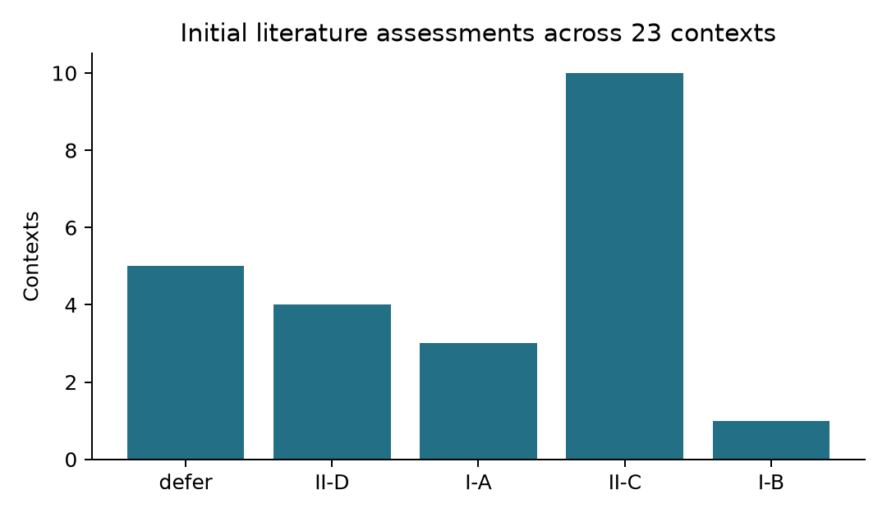
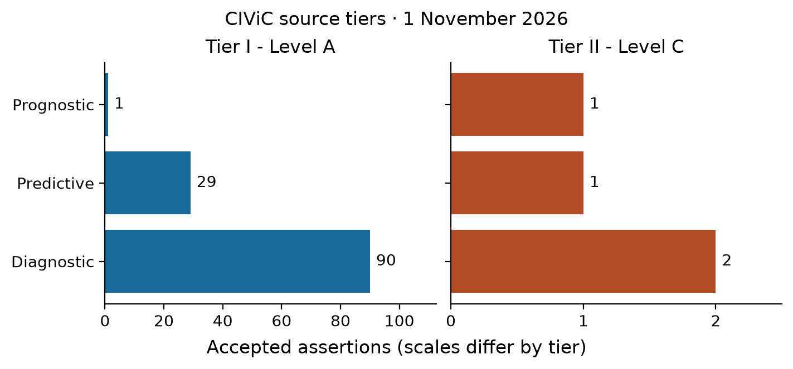

# Tumor-Specific Somatic Variant Evidence and AMP Tier Assessment

How does the evidence available for a molecular profile affect its tier in a specific tumor? The expanded audit compared 23 contexts against accepted CIViC assertions. Four of 18 assigned assessments matched the broad reference tier, and five contexts were deferred. The comparator usually incorporated several studies and sometimes regulatory labels or professional diagnostic criteria. All 14 assigned discrepancies were Tier II against a Tier I reference. Nine involved diagnostic criteria omitted from the selected literature, four involved therapeutic evidence, and one involved colorectal prognosis.



[Audited data](../comparative_genomics/oncology/comparison.tsv) · [Full methods and reproduction](../comparative_genomics/README.md) · [Scientific audit](../FINAL_AUDIT.md)

## Baseline experiment

This workflow extracts tiered assertions from the **1 November 2026** CIViC release and audits six selected literature reviews against accepted CIViC evidence items. Each review is scoped to the molecular profile, disease and clinical significance represented in the assertion. The six records cover predictive and diagnostic contexts, including a hematologic case report and examples with disease-matched regulatory labeling.

## Reproduce

```bash
p=oncology_somatic_variant_interpretation
r=01-Nov-2026
mkdir -p "$p/data" "$p/results"
for kind in Assertion ClinicalEvidence; do
  filename="$r-Accepted${kind}Summaries.tsv"
  curl -fLsS "https://civicdb.org/downloads/$r/$filename" -o "$p/data/$filename"
done
python3 "$p/run.py" extract --assertions "$p/data/$r-AcceptedAssertionSummaries.tsv" \
  --accepted-only-export --out "$p/results"
python3 "$p/run.py" audit --source "$p/results/accepted_assertions.tsv" --review "$p/review_completed.tsv" \
  --evidence "$p/data/$r-AcceptedClinicalEvidenceSummaries.tsv" --out "$p/results"
```

The dated accepted-only assertion export omits a status column. CIViC’s GraphQL `dataReleases.acceptedAssertionTsv.path` confirmed the filename. Use `--accepted-only-export` only when release provenance establishes acceptance. For a file with explicit statuses the parser retains accepted rows.

## Results and interpretation

- [Accepted assertions](results/accepted_assertions.tsv), [tier and context table](results/tier_by_assertion_type.tsv), and [tier plot](results/tier_by_assertion_type.png).
- [Evidence reviews](results/oncology_assessments.md), [audited review table](results/reviewed_assertions.tsv), and [source counts and hash](results/summary.json).

Assertion IDs may represent fusions, amplifications, or composite molecular profiles. The dated release and the selected review set are both enriched for clinically established assertions. Source tiers are published prior knowledge. The reviews are descriptive applications of the 2017 tier framework to cited evidence, with no blinded comparison or clinical decision-making.

[CIViC releases](https://civicdb.org/releases/main) · [Assertions overview](https://docs.civicdb.org/en/latest/model/assertions/overview.html) · [AMP/ASCO/CAP consensus framework](https://pubmed.ncbi.nlm.nih.gov/27993330/)



Published CIViC tiers across 124 accepted assertions, grouped by clinical context. [Vector figure](results/tier_by_assertion_type.pdf)

Two FDA PDF URLs in the archived baseline report have expired. The final audit links their DailyMed replacements under “References, figures and scope.” [Regulatory source audit](../FINAL_AUDIT.md)
