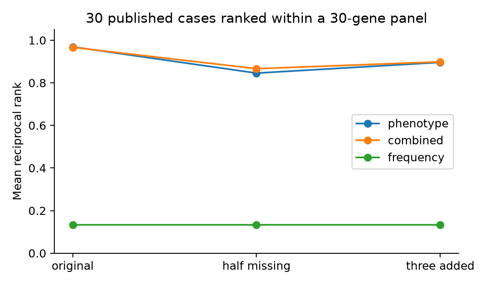
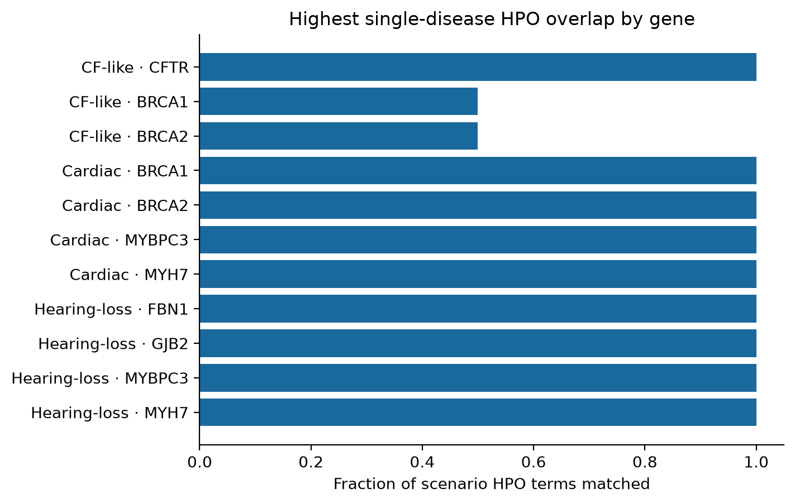

# Phenotype-Driven Gene Prioritization and Germline Evidence Curation

How often does phenotype overlap recover a published causal gene, and how much does that result depend on annotation provenance? Within a fixed panel of 30 candidate alleles, phenotype-only Top-1 was 95.0%. Requiring explicitly different publication support reduced it to 45.5%. The result measures recognition of published phenotypes within an enriched panel. The separate review reconstructs 19 expert assessments across five germline classes.



[Audited data](../comparative_genomics/rare/evidence_reviews.tsv) · [Full methods and reproduction](../comparative_genomics/README.md) · [Scientific audit](../FINAL_AUDIT.md)

## Baseline experiment

The workflow screens GRCh38 expert-panel and practice-guideline ClinVar SNVs in a fixed 20-gene set. It ranks retained genes by exact HPO overlap within the best single annotated disease, keeping ties and skipping HPO annotations with zero frequency. The queue takes up to 20 variants per gene and scenario by ascending ClinVar ID. The three phenotype scenarios are synthetic and contain no sample genotypes.

## Reproduce

The ClinVar file used was last modified on 23 November 2026. HPO and gnomAD were retrieved on 24 November 2026. The mutable endpoints below may now serve a different snapshot. Compare the input hashes with `results/summary.json` and `results/gnomad_frequencies.tsv`.

```bash
r=rare_disease_variant_curation
mkdir -p "$r/data" "$r/results"
curl -fLsS https://ftp.ncbi.nlm.nih.gov/pub/clinvar/tab_delimited/variant_summary.txt.gz -o "$r/data/variant_summary.txt.gz"
curl -fLsS https://purl.obolibrary.org/obo/hp/hpoa/genes_to_phenotype.txt -o "$r/data/genes_to_phenotype.txt"
python3 "$r/run.py" prioritize --clinvar "$r/data/variant_summary.txt.gz" \
  --hpo "$r/data/genes_to_phenotype.txt" --cases "$r/cases.tsv" --limit 20 --out "$r/results"

for pair in 17000:13-20189481-A-G 17023:13-20189473-C-T; do
  id=${pair%%:*}
  allele=${pair#*:}
  curl -fLsS https://gnomad.broadinstitute.org/api -H 'Content-Type: application/json' \
    --data "$(printf '{"query":"{ variant(variantId: \"%s\", dataset: gnomad_r4) { exome { ac an populations { id ac an } } genome { ac an populations { id ac an } } } }"}' "$allele")" \
    -o "$r/data/gnomad_$id.json"
done
python3 "$r/review_gjb2.py" --data "$r/data" --out "$r/results" --retrieved 2026-11-24
```

## Results and interpretation

- [Candidate queue](results/candidate_queue.tsv), [gene-level table](results/phenotype_gene_scores.tsv), and [HPO score plot](results/phenotype_gene_scores.png).
- [GJB2 research assessments](results/variant_assessments.md), [structured evidence](results/curation_review.tsv), and [gnomAD allele counts](results/gnomad_frequencies.tsv). These two entries reconstruct the published ClinGen Hearing Loss VCEP assessments for p.Met34Thr and p.Val37Ile. They address DFNB1A and the effect of reduced penetrance on frequency evidence.
- OMIM disease identifiers come from HPO mappings and the DFNB1A identifier was cross-checked in the NCBI GeneReviews OMIM table. The direct OMIM page was inaccessible during this run. The gnomAD figures are observed allele counts and frequencies for the API’s `gnomad_r4` dataset, reported by exomes and genomes separately. They differ from filtering allele frequency.
- Exact HPO matching gives equal weight to occasional and characteristic findings, and single-term scenarios produce broad ties. The phenotype score attaches to a gene’s disease annotations. The queue also contains aggregate ClinVar disease labels, which can reference several disorders. The review documents one specific gene–disease relationship. No patient-level accuracy or independent germline classifications were measured.

## Sources

[ACMG/AMP framework](https://pubmed.ncbi.nlm.nih.gov/25741868/) · [ClinVar downloads](https://www.ncbi.nlm.nih.gov/clinvar/docs/downloads/) · [HPO annotations](https://obophenotype.github.io/human-phenotype-ontology/annotations/genes_to_phenotype/) · [ClinGen hearing loss specifications v2](https://clinicalgenome.org/site/assets/files/7814/clingen_hl_acmg_specifications_cdh23_coch_gjb2_kcnq4_myo6_myo7a_slc26a4_tecta_ush2a_v2.pdf) · [Shen et al.](https://pubmed.ncbi.nlm.nih.gov/31160754/) · [OMIM cross-reference table](https://www.ncbi.nlm.nih.gov/books/NBK1272/table/dfnb1.molgen.TB/) · [gnomAD](https://gnomad.broadinstitute.org/)



Single-disease HPO overlap for 11 gene–scenario pairs across three synthetic scenarios. [Vector figure](results/phenotype_gene_scores.pdf)
