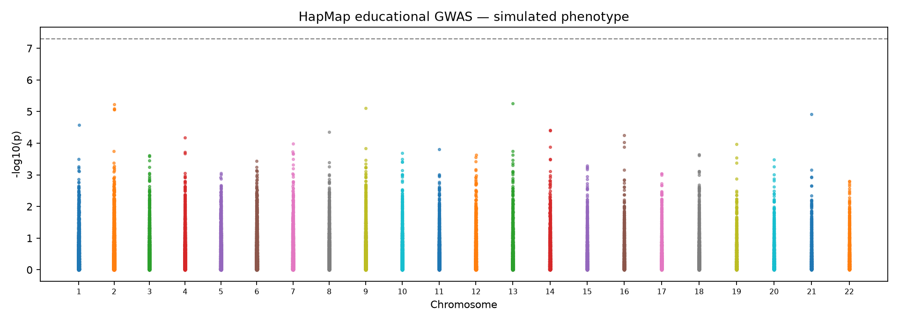
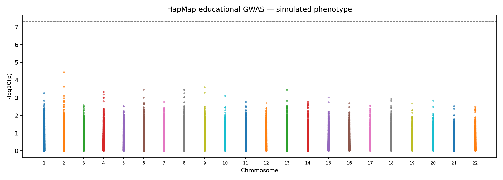
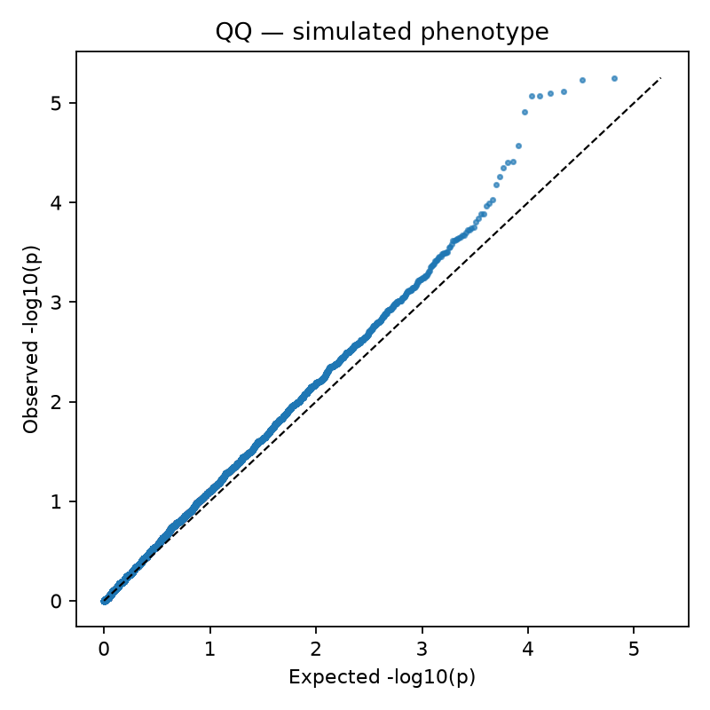
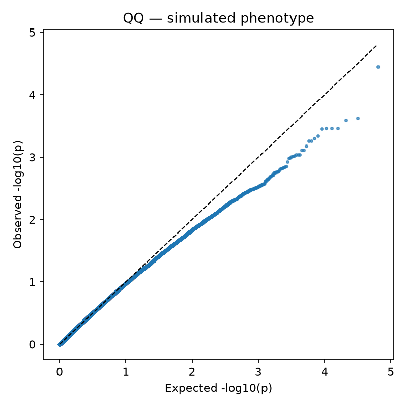
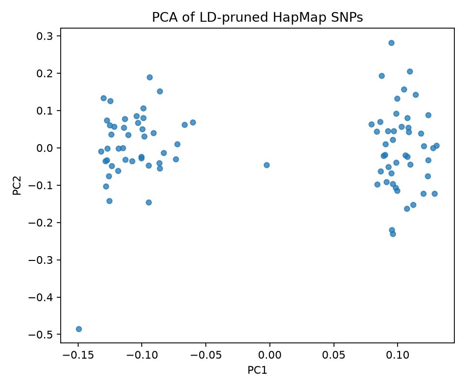

# HapMap Genotyping Quality Control and GWAS Analysis

I analyzed a public HapMap genotype dataset using PLINK and Python to assess data quality, explore genetic variation among samples, and compare association results before and after adjusting for population structure.

The dataset contains 89 individuals and 83,534 SNPs. The phenotype supplied with the tutorial data is **simulated**, so the association results are used to demonstrate the workflow rather than identify disease-related variants.

## What I did

- Calculated sample and SNP missingness, allele frequencies, Hardy–Weinberg statistics, and heterozygosity.
- Applied genotype quality filters for missingness, minor allele frequency, and Hardy–Weinberg equilibrium.
- Performed LD pruning and principal component analysis (PCA) to examine genetic population structure.
- Ran unadjusted association tests and logistic regression adjusted for three principal components.
- Generated Manhattan, QQ, and PCA plots, along with an HTML report summarizing the QC and GWAS results.

## Results

| Measure | Result |
| --- | ---: |
| Samples before and after QC | 89 → 89 |
| SNPs before QC | 83,534 |
| SNPs retained after QC | 64,651 |
| SNPs excluded | 18,883 (22.6%) |
| Mean sample missingness before QC | 0.559% |
| Minimum unadjusted p-value | 5.586 × 10⁻⁶ |
| Minimum PCA-adjusted p-value | 3.544 × 10⁻⁵ |

All 89 samples were retained after the selected QC filters; 64,651 SNPs remained for analysis. The smallest p-values did not meet the conventional genome-wide significance threshold of 5 × 10⁻⁸. Because the phenotype is simulated and the dataset is small, I do not interpret the association results as biological discoveries.

## Figures

| Unadjusted Manhattan plot | PCA-adjusted Manhattan plot |
| --- | --- |
|  |  |

| Unadjusted QQ plot | PCA-adjusted QQ plot |
| --- | --- |
|  |  |



The HTML report and QC summary are available in [`docs/results/`](docs/results/).

## Run the analysis

Requires macOS, Python 3, and PLINK 1.9.

```bash
brew install plink1
python3 -m venv .venv
source .venv/bin/activate
pip install -r requirements.txt
bash scripts/get_data.sh
bash scripts/run.sh
python3 -m unittest discover -s tests -v
open results/report.html
```

The download script obtains the public HapMap tutorial data. The analysis script produces QC statistics, association results, figures, and an HTML report in `results/`. Downloaded genotype files and intermediate outputs are excluded from Git; selected figures and reports can be shared under `docs/results/`.
