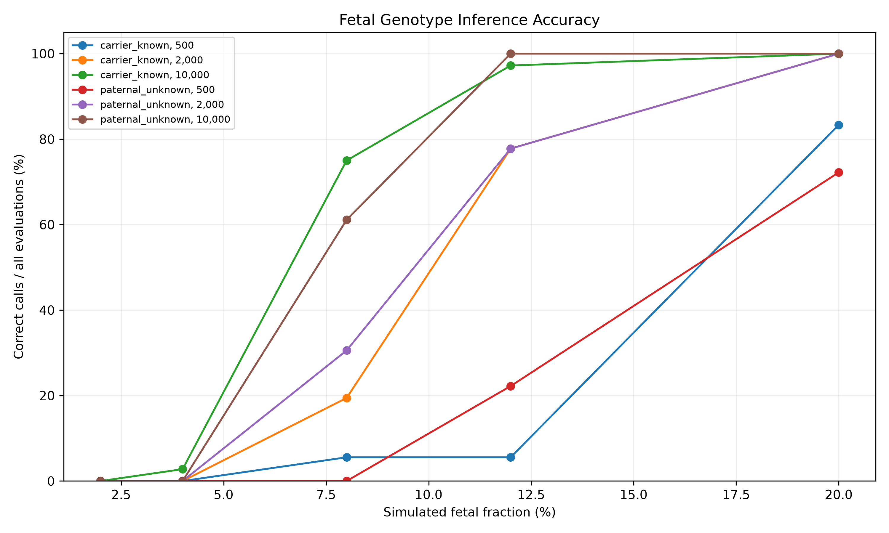
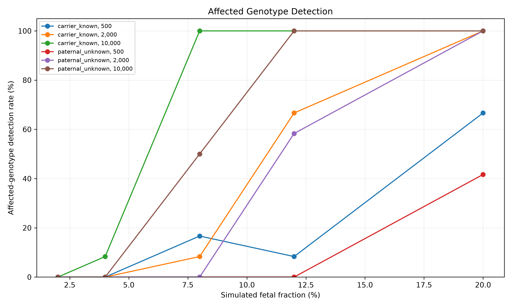
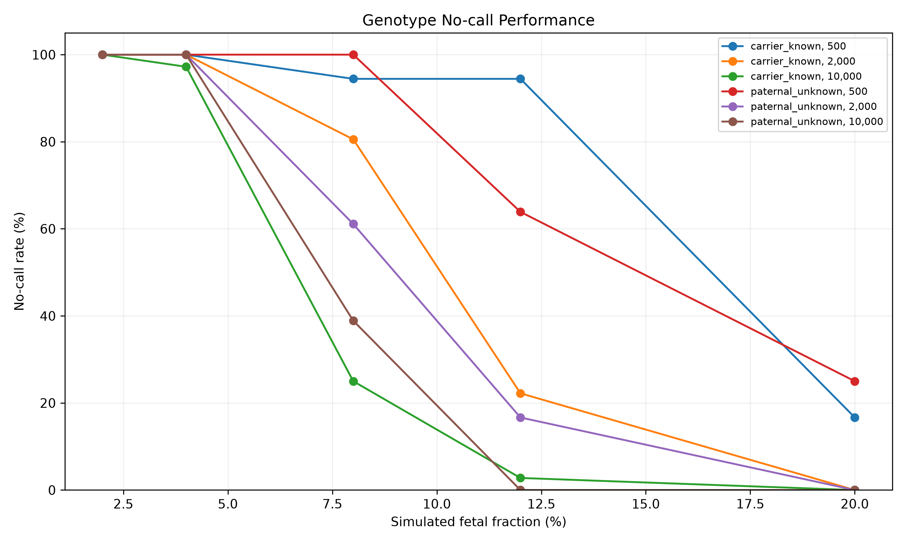

# ClinVar-Integrated Single-Gene Screening

Targeted cell-free DNA sequencing and Bayesian fetal genotype inference for pathogenic variants associated with inherited genetic disorders.

## Target Variants

| Gene | ClinVar Variation ID | dbSNP |
|---|---:|---|
| HBB | 15333 | rs334 |
| CFTR | 7120 | rs75527207 |
| HEXA | 188954 | rs786204585 |
| GJB2 | 590799 | rs1302739538 |

## Methodology

- ClinVar variant extraction and clinical significance filtering.
- Pathogenic variant selection based on review status.
- Reference allele validation against GRCh38.
- Multiplexed paired-end sequencing simulation.
- BWA-MEM alignment and SAMtools processing.
- Directional UMI error correction and molecular consensus.
- Beta-binomial likelihood modeling.
- Bayesian fetal genotype inference using Mendelian inheritance priors.
- Posterior confidence-based genotype classification.

## Variant Annotation

| Metric | Result |
|---|---:|
| ClinVar records processed | 4,621,342 |
| Target-gene-associated records | 10,226 |
| Pathogenic and likely pathogenic SNVs | 1,357 |
| High-confidence pathogenic SNVs | 453 |
| Selected target variants | 4 |

## Molecular Sequencing Benchmark

| Metric | Result |
|---|---:|
| Multiplexed sequencing samples | 135 |
| Sample-gene experiments | 540 |
| Original DNA molecules | 2,250,000 |
| Sequencing reads | 13,400,332 |
| UMI families merged | 119,575 |
| Accepted consensus molecular families | 1,913,294 |
| Mean molecular family count ratio | 85.10% |
| VAF error reduction | 10.37% |

## Bayesian Genotype Inference

Fetal genotype posterior probabilities were calculated using maternal genotype, fetal fraction uncertainty, molecular allele counts, and paternal inheritance information.

Genotype predictions required a minimum posterior confidence of 95%.

| Metric | Paternal Carrier Known | Paternal Unknown |
|---|---:|---:|
| Evaluations | 540 | 540 |
| Correct calls | 204 | 203 |
| Incorrect calls | 0 | 11 |
| No-calls | 336 | 326 |
| Called genotype accuracy | 100% | 94.86% |
| No-call rate | 62.22% | 60.37% |
| Affected genotype detection | 38.33% | 30.00% |
| False-positive affected genotype calls | 0 | 0 |

Combined accuracy among called genotypes was 97.37%, with an overall no-call rate of 61.30%.

Higher fetal fractions and molecular depths improved genotype discrimination under the simulated experimental conditions.

## Performance Visualizations

### Genotype Accuracy

### Affected Genotype Detection

### No-Call Performance

## Implementation

- [ClinVar variant extraction](../ngs_pipeline/scripts/extract_clinvar_variants.py)
- [Target variant selection](../ngs_pipeline/scripts/select_clinvar_targets.py)
- [Sequencing simulation](../ngs_pipeline/scripts/simulate_single_gene.py)
- [Molecular quantification](../ngs_pipeline/scripts/quantify_single_gene.py)
- [Bayesian genotype inference](../ngs_pipeline/scripts/infer_single_gene_genotypes.py)
- [Benchmark results](../results/ngs/single_gene/benchmark/)

## Technologies

Python, NumPy, Pandas, SciPy, PySAM, BWA-MEM,
SAMtools, ClinVar, GRCh38, FastQC, MultiQC, and Matplotlib.

## Research Scope

The workflow uses synthetic sequencing data, simulated fetal fraction estimates, and experimental inheritance priors. The same 540 sample-gene experiments were evaluated under two paternal information models. Reported results do not establish clinical diagnostic validity.
